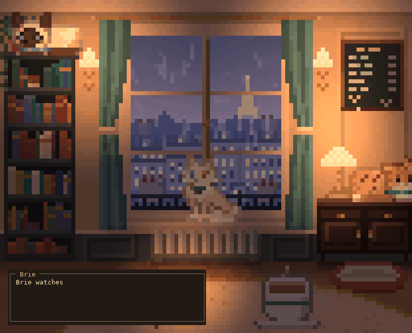
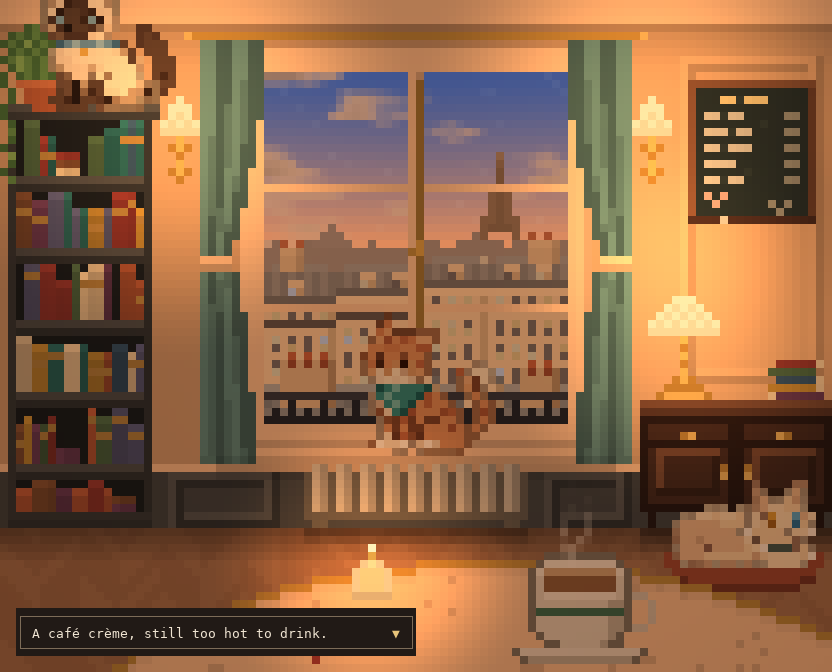

# Coffee and Toe Beans

A cosy, silent café for your terminal. You sit at a table in **Coffee and
Toe Beans**, a small cat café on the rooftops of Paris. Rain runs down the
window, the lamps come on in the evening, the Eiffel Tower glitters on the
hour, and three cats (Brie, Hunter and Mimi) slowly get to know you.

There is nothing to win and nowhere to be. Order a drink, watch the
weather, answer a cat when it comes over, or simply leave it open while you
work. Bring your own music.





## Play

Download the game for your computer from the
**[latest release](https://github.com/natalielpx/coffee-and-toe-beans/releases/latest)**.
There's nothing to install: it's one small program.

| Your computer | Download |
|---|---|
| Mac with Apple silicon (M1, M2, M3, M4…) | `coffee-and-toe-beans-macos-apple-silicon.zip` |
| Mac with an Intel processor | `coffee-and-toe-beans-macos-intel.zip` |
| Linux, or Windows with WSL (most PCs) | `coffee-and-toe-beans-linux-x86_64.zip` |
| Linux on ARM (Raspberry Pi 4/5 with 64-bit OS, ARM laptops) | `coffee-and-toe-beans-linux-arm64.zip` |

Not sure which Mac you have? Apple menu → **About This Mac**: "Chip Apple
M…" means Apple silicon; "Processor … Intel" means Intel. On Linux or WSL,
type `uname -m`: `x86_64` or `aarch64` (that's arm64).

### On a Mac

1. Download the zip for your Mac and double-click it in your Downloads
   folder. You get a folder called `coffee-and-toe-beans-macos-…`.
2. Open **Terminal** (in Applications → Utilities) and make the window
   big enough (see [Window size](#window-size)).
3. Type `cd ~/Downloads/coffee-and-toe-beans-macos-` and press **Tab** to
   finish the name, then **Return**. Then type `./coffee-and-toe-beans` and
   press **Return**.
4. **The first time**, macOS says it can't check the app for malicious
   software, because the game isn't from the App Store. Click **Done**, then:
   - open the Apple menu → **System Settings** → **Privacy & Security**,
   - scroll down to *"coffee-and-toe-beans" was blocked…* and click
     **Open Anyway**, then enter your password,
   - go back to Terminal, run `./coffee-and-toe-beans` again and click
     **Open Anyway** once more.

   macOS remembers this: from then on the café opens straight away.

   (If you're comfortable in Terminal, `xattr -d com.apple.quarantine
   coffee-and-toe-beans` in the game's folder does the same.)

To open the café from any folder later, move it somewhere on your path:
`sudo mv coffee-and-toe-beans /usr/local/bin/` (then just type
`coffee-and-toe-beans`).

### On Linux

```sh
unzip coffee-and-toe-beans-linux-x86_64.zip      # or ...-linux-arm64.zip
cd coffee-and-toe-beans-linux-x86_64
./coffee-and-toe-beans
```

### On Windows (with WSL)

The café runs in WSL, the Linux that comes with Windows, inside
**Windows Terminal**. If you don't have WSL yet, open PowerShell and type
`wsl --install`, then restart. Then open **Ubuntu** from the Start menu and
type:

```sh
sudo apt install unzip
curl -LO https://github.com/natalielpx/coffee-and-toe-beans/releases/latest/download/coffee-and-toe-beans-linux-x86_64.zip
unzip coffee-and-toe-beans-linux-x86_64.zip
cd coffee-and-toe-beans-linux-x86_64
./coffee-and-toe-beans
```

(On an ARM Windows laptop, use `linux-arm64` instead of `linux-x86_64`.)

## Window size

The café needs a window at least **104 columns wide and 42 rows tall**. If
it's smaller, the game says so politely and waits for you to make it bigger.

- **macOS Terminal:** Terminal → **Settings…** → **Profiles** → your profile
  (the highlighted one) → **Window** → *Window Size*: Columns **104**, Rows
  **42**. Open a new window for it to take effect. Tip: in the **Text** tab,
  click *Change…* under Font and set line spacing to **1** so there are no
  thin lines between rows.
- **Windows Terminal:** Settings → **Startup** → *Launch size*: Columns
  **104**, Rows **42** → Save, then open a new window.
- **Anywhere else:** drag the window bigger, or make the font a little
  smaller.

## Controls

The whole café is played with the arrow keys, Enter and Esc.

| Key | What it does |
|-----|--------------|
| ↑ ↓ | choose |
| Enter or Space | confirm; show the whole line at once; turn the page |
| Esc | the menu: Order a drink · Look around · Settings · Leave the café (Esc again closes it) |
| ← → | in Look around: move between the window, the cats and your table; in Settings: change a setting |

Leaving always goes through the menu (Esc, then *Leave the café*), so you
never close the café by accident. The narrator's questions pass by
themselves if you leave them alone; a cat who comes to you waits for your
answer. A drink cools and empties over about 15 minutes.

## Settings

Esc → **Settings** (also on the title card). Changes apply at once and are
remembered.

| Setting | Choices |
|---|---|
| Reduced motion | Off · On: calmer, sparser rain and snow, no flicker or twinkle, shorter fades |
| Quiet mode | Off · On: half as much small talk, and the cats come to you half as often |
| Text speed | Slow · Normal · Instant |
| Pacing | Gentle (a cat every 10–20 minutes) · Very slow (every 15–30) |
| Weather | Changing (on its own, mostly rain) · Clear · Cloudy · Drizzle · Rain · Heavy rain · Fog · Snow |
| Time of day | Real clock (Paris's real sunrise and sunset) · Dawn · Morning · Afternoon · Golden evening · Night |
| Colours | Auto · True colour · 256 |

If the colours look strange, choose **256**. macOS Terminal before macOS 26
shows 256 colours; iTerm2, Ghostty, Windows Terminal and most Linux
terminals show true colour.

## Your save

The café remembers you between visits: how well each cat knows you, the
moments you've shared, your favourite drink, your settings, and the time
you've spent here. It saves every minute and when you leave.

| | Where the save lives |
|---|---|
| macOS | `~/Library/Application Support/coffee-and-toe-beans/save.json` |
| Linux and WSL | `~/.config/coffee-and-toe-beans/save.json` |

**To start afresh**, run the game once with `--fresh`
(`./coffee-and-toe-beans --fresh`). Your old save is kept next to the new
one as a backup. (Or simply delete `save.json`.) If the save ever gets
damaged, the game keeps a copy, starts afresh and tells you where the copy
is when you leave.

## Build from source

You need [Go](https://go.dev/dl/) 1.24 or newer.

```sh
git clone https://github.com/natalielpx/coffee-and-toe-beans.git
cd coffee-and-toe-beans
go run ./cmd/coffee-and-toe-beans
```

`go test ./...` runs the tests. For trying things out:

```sh
go run ./cmd/coffee-and-toe-beans --time 19:30           # start at any hour
go run ./cmd/coffee-and-toe-beans --fast                 # time runs 30x faster
go run ./cmd/coffee-and-toe-beans --away 3d              # pretend your last visit was 3 days ago (45m, 3h, 2d, 1w)
go run ./cmd/coffee-and-toe-beans --weather snow         # clear, cloudy, drizzle, rain, heavy_rain, fog, snow
go run ./cmd/coffee-and-toe-beans --color 256            # force 256 colours (or truecolor)
go run ./cmd/snapshot --time 07:00 --weather fog         # print one still frame and exit
go run ./cmd/snapshot --screen settings --row 5          # the settings screen (or: title, menu, drinks, talk)
```

Runs with `--fast` or `--time` keep a save of their own (`save-test.json`
next to the real one), so trying things out never changes your real café.

### Changing the art and words

Everything you see or read lives in `content/`, as plain text and JSON:

- `content/sprites/*.txt`: pixel art (see `content/sprites/README.md`)
- `content/interiors/french.json`: the room's layout, colours and lamps
- `content/view.json`: the view of Paris
- `content/lighting.json`: how each hour is lit, and the times you can pick in Settings
- `content/weather.json`: the kinds of weather and how they follow each other
- `content/text/ui.json`: the title card, menus, settings and notes
- `content/dialogue/cafe.json`: the drink offers and what's said about your cup
- `content/narrator/`: the welcome lines, "while you were away" notes and small talk
- `content/cats/*.json`: each cat's name, poses and habits
- `content/moments/*.json`: each cat's moments, Look around words and away lines
- `content/look.json`: Look around words for the window and your table
- `content/drinks.json`: the menu, serving hours and how fast a cup is drunk
- `content/pacing.json`: how often things happen, and the timings behind the settings

After editing, run `go test ./...`: if something is wrong in a file, it
tells you which file and which line.

## Support the café

Coffee and Toe Beans is free and open source. If it keeps you company, you
can help keep it warm:

- **GitHub Sponsors**: coming soon
- **Ko-fi**: coming soon
- **itch.io** (pay what you want): coming soon

Sponsors are thanked in [SPONSORS.md](SPONSORS.md). One day you'll be able
to commission a cat of your own for the café.

## License

MIT, see [LICENSE](LICENSE). Made with
[Bubble Tea](https://github.com/charmbracelet/bubbletea).
